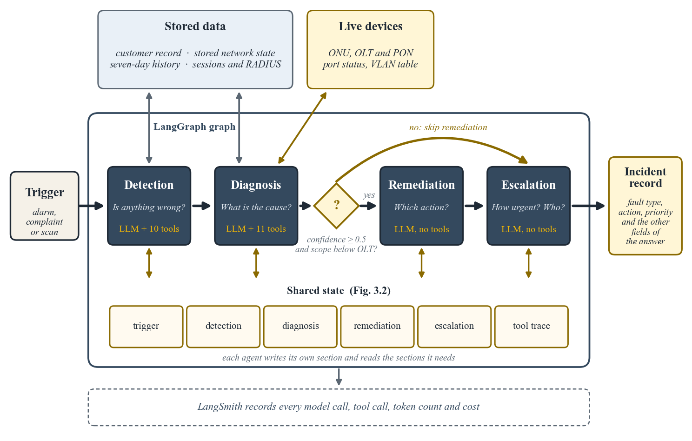
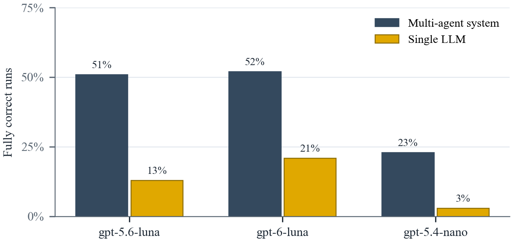

# Designing and Evaluating an LLM-Based Multi-Agent System for Network Fault Diagnosis

MSc dissertation, Angela Krstevska, 2026.

Does a multi-agent system diagnose network faults better than a single LLM, and under what
conditions? This repository holds the system, the single-LLM baseline, the 35 test
scenarios and the evaluation that answer that question for an EPON access network.

## The system

Four agents in LangGraph, one for each step of fault handling. Detection reads the stored
data and decides whether anything is wrong. Diagnosis queries the live devices and finds the
cause. Remediation picks an action and escalation sets the priority and the team. All four
share one state, and a decision point after diagnosis skips remediation when confidence is
low or the fault is wider than one customer.



It is compared with a single LLM in two versions: one with a general prompt, and one with
all the rules of the agents in a single prompt. Both see the same stored data and give the
same answer fields.

## Results

735 runs: three systems, three OpenAI models, 35 scenarios reviewed by a network engineer.



- The multi-agent system was fully correct about four times as often as the single LLM on
  the main model (51% against 13%). The single LLM usually found the fault but set the
  priority too high.
- It was also more consistent: the same answer in all three runs on most scenarios.
- Most of the gain comes from the instructions. With all the agents' rules, the single LLM
  came close in accuracy; the architecture added consistency and a trace of every step.
- It cost 4.5 times more, but less than one US cent and under a minute per case.

Every run is recorded in LangSmith: each model call, tool call, token count and cost.

## Repository

```
pipeline/     the multi-agent system: graph, routing, state, tools, one file per agent
  agents/     detection, diagnosis, remediation, escalation
  prompts/    one prompt per agent, plus the shared thresholds
baseline/     the single LLM
evaluation/   dataset upload, experiments, evaluators, export and analysis
  results/final/   the exported runs and scores of the nine final experiments
scenarios/    35 scenario JSON files and the validator
docs/         calibration of the thresholds, fault taxonomy, scenario schema and changelog
```

The scenarios are synthetic. They follow the structure and normal values of a real ISP
network but contain no real customer data.

## Running it

Python 3.13.

```bash
python -m venv .venv
source .venv/bin/activate
pip install -r requirements.txt
```

Create a `.env` file with your keys:

```
OPENAI_API_KEY=...
ANTHROPIC_API_KEY=...      # the LLM judge
LANGSMITH_API_KEY=...
LANGSMITH_TRACING=true
LANGSMITH_PROJECT=...
MODEL=gpt-5.6-luna
```

Run one scenario through the four agents, without LangSmith:

```bash
cd pipeline
python run.py FD-001
```

Reproduce the results (each command is repeated for each model and system):

```bash
python scenarios/validate_scenarios.py scenarios
python evaluation/dataset.py
MODEL=gpt-5.6-luna python evaluation/run_experiment.py --split base --repeat 3
MODEL=gpt-5.6-luna python evaluation/run_experiment.py --config monolithic_stored --split base --repeat 3
python evaluation/run_experiment.py --add-judge <experiment> --judge-repeats 3
python evaluation/export.py
python evaluation/analysis.py
```

`--config` takes `agent` (default), `monolithic_stored` or `monolithic_shared_stored`.
Use `--split smoke` for a quick run on 5 scenarios. A single case costs less than one cent.
